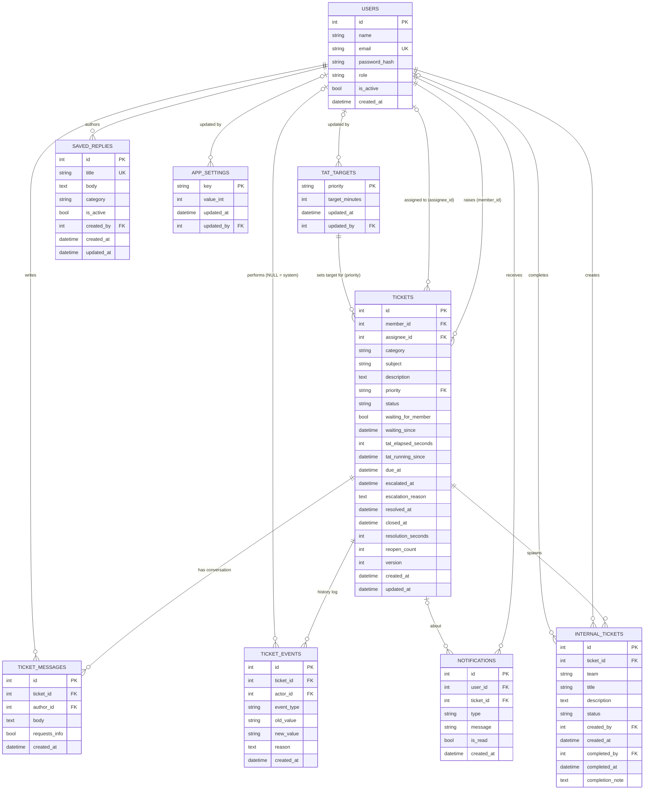

# Database ERD

Users have unique lower-cased email. Ticket IDs are SQLite autoincrement primary keys displayed as `TKT-{id:04d}` and never reused. Enum-like values use lowercase strings and checks. Foreign keys are enabled; ticket list/search, status, due time, creation time, notification ownership/read state, and message chronology are indexed.

The planned SQLAlchemy models and one initial Alembic migration must match this ERD column by column. All datetimes are UTC-aware in Python and serialized as ISO-8601 `Z` values.

